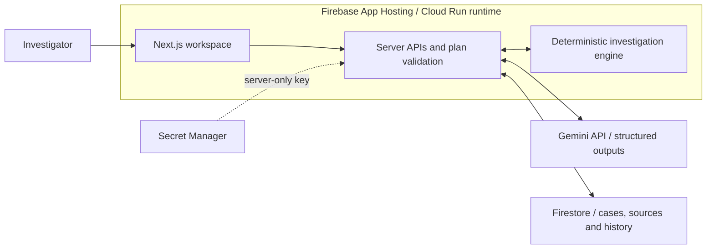

# Coconut

**Investigate what you know. Test what you don’t.**

Coconut helps financial investigators work through missing or conflicting evidence. Describe an unknown, explore the explanations Gemini proposes, and see how each retrieved record changes the investigation.

[Live demo](https://coconut--coconut-73726.us-central1.hosted.app/) · AI Builder Cup · Team TheHundred

## The investigation

1. Open a case and inspect its activity, relationships, sources and counter-evidence.
2. In **Possibilities**, describe a missing fact, such as the source of the funds.
3. Gemini proposes conditional explanations and the evidence to obtain for each.
4. Run bounded source-consistency checks, retrieve available records, and inspect which explanations remain compatible or conflicting.
5. Rewind the evidence history, ask a follow-up question, or export a readable report for human review.

The prototype includes six synthetic cases and 20 structured source documents. It supports up to three investigator-defined unknowns and 125 combinations per simulation. Missing evidence keeps questions open; conflicting records remain unresolved.

Gemini calls are live. The included records are authored demonstration data, not real customer data. A matching source assertion does not establish that it is true, and the simulation does not estimate fraud probabilities or predict real-world outcomes.

## Architecture



Gemini interprets questions and proposes investigation trails. Server validators constrain the proposals and bind follow-up answers to checked facts. The TypeScript engine evaluates record scope, authorization checks, conflicts and combinations. Firestore persists cases, source records, workspaces and evidence history.

The interface uses React, Three.js and GSAP. Server-side Firestore access uses the Firebase Admin SDK; direct browser access is denied by the supplied rules.

## Run locally

Use **Node.js 22.22 or later within the 22.x release line**. The local Firestore emulator also needs **Java 21 or later**. You need your own Gemini API key.

```bash
npm ci
cp .env.example .env.local
```

In `.env.local`, set `GEMINI_API_KEY`, `GCLOUD_PROJECT=demo-coconut-local` and `FIRESTORE_EMULATOR_HOST=127.0.0.1:8086`. Keep `COCONUT_APP_ORIGIN` blank for localhost. The default model is `gemini-flash-latest`.

Start the emulator in one terminal:

```bash
npm run emulators
```

Then seed the synthetic records and start the app in another terminal:

```bash
node --env-file=.env.local scripts/seed-firestore.mjs
npm run dev
```

Open [localhost:3000](http://localhost:3000). The database runs locally; AI requests use the real Gemini API and may incur usage charges.

To use your own cloud Firestore database, remove `FIRESTORE_EMULATOR_HOST`, set your Google project ID, and configure Application Default Credentials or a private credential file through `GOOGLE_APPLICATION_CREDENTIALS`. Seed it explicitly with:

```bash
node --env-file=.env.local scripts/seed-firestore.mjs --cloud
```

The seed checks case totals, source references and document scope before writing. It does not delete existing workspaces.

## Build and deployment

```bash
npm run typecheck
npm run build
npm start
```

`apphosting.yaml` describes the deployed Firebase App Hosting runtime: one CPU, 1 GiB memory, zero minimum instances and a maximum of two instances. It references a Secret Manager secret named `GEMINI_API_KEY`. All model calls share an hourly allowance, defaulting to 24 attempts.

For your own deployment, update the project ID and public origin in `apphosting.yaml`, configure the secret and server IAM access, and use your Firebase project explicitly in CLI commands. `firebase.json`, `firestore.rules` and `firestore.indexes.json` contain the hosting and database configuration. Building this project does not deploy it.

The public demonstration has no user sign-in and is intended for synthetic data. Browser workspaces use HttpOnly cookies and revision-checked updates. Institutional roles, tenant isolation and production banking integrations are future work. Findings remain drafts for human review.
